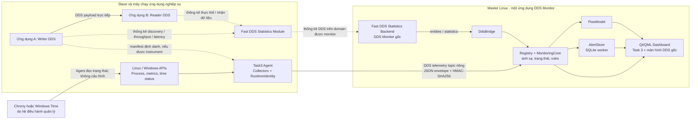

# BÁO CÁO TỔNG QUAN TRIỂN KHAI HỆ THỐNG GIÁM SÁT MASTER–SLAVE SỬ DỤNG DDS

## Phạm vi và cách đánh giá

Báo cáo đối chiếu yêu cầu trong `docs/task3/TASK3_REQUIREMENTS.md` với mã nguồn tại `/home/dev/DDS-Monitor`. Cơ chế được mô tả dựa trên source; trạng thái kiểm chứng dựa trên test artifacts của chính repository này. “Đã triển khai” không đồng nghĩa với “đã nghiệm thu trên mọi nền tảng”: các lượt tích hợp hiện có chạy trên một máy Linux, còn Windows, NTP liên máy và nhiều máy vật lý vẫn chờ kiểm thử ngoài.

## 1. Bài toán và phương án đang triển khai

Requirements yêu cầu Master Linux tập trung trạng thái Slave Linux/Windows, ứng dụng/tiến trình/dịch vụ, thực thể và luồng DDS, thống kê, đồng bộ thời gian và sự kiện. Tiến trình còn chạy không chứng minh Writer vẫn gửi; thiếu thống kê cũng không đủ để kết luận Writer dừng.

Source ghép hai nguồn quan sát trong cùng Desktop: Agent trên Slave gửi telemetry OS qua DDS topic riêng; DDS Monitor gốc lấy thống kê Fast DDS qua Statistics Backend. Task 3 bổ sung Registry, ánh xạ, topology, cảnh báo, lịch sử và trang Qt/QML.

Kiến trúc phù hợp CON-01…CON-04: ứng dụng nghiệp vụ trao đổi DDS trực tiếp, Master không chuyển tiếp payload và không cần Web Server/Prometheus. Khoảng cách đáng kể: FR-08 yêu cầu tự khởi động dịch vụ đồng bộ, nhưng code chỉ đọc trạng thái; Chrony/Windows Time phải do quản trị viên cấu hình.

## 2. Kiến trúc thực tế và vai trò thành phần

DDS Monitor gốc cung cấp cửa sổ, Engine, Backend connection, model và màn hình thống kê. Task 3 thêm Agent, Registry/MonitoringCore, FlowModel, AlertStore và trang QML. Fast DDS, Qt, API hệ điều hành và dịch vụ thời gian là dependency ngoài.

`DdsTransport` gửi CDR chứa JSON envelope có schema và HMAC-SHA256 (xác thực, không mã hóa). `MonitoringCore` xác thực rồi cập nhật Registry/rules; `DdsBridge` đọc Backend; `FlowModel` tạo topology có bằng chứng; `AlertStore` ghi SQLite ở worker thread. QML bind các model này để hiển thị Host, ứng dụng, DDS, topology và sự kiện.

## 3. Hệ thống hoạt động qua một kịch bản

Giả sử Master Linux chạy DDS Monitor; Slave 1 chạy Agent và ứng dụng A; Slave 2 chạy Agent và ứng dụng B. A ghi mẫu bằng DataWriter, B đọc bằng DataReader. Hai ứng dụng trao đổi payload trực tiếp theo Domain/Topic DDS của chúng. Mỗi máy cần Agent nếu cần trạng thái OS và liên kết máy–ứng dụng; các bài kiểm thử đã chạy A/B trên cùng máy Linux, chưa chứng minh kịch bản nhiều máy vật lý.

### Luồng A — Máy và phần mềm

Agent lấy mẫu theo `interval_ms` (mặc định 1.000 ms). Linux dùng `/proc/stat`, `/proc/meminfo`, `/proc/net/dev`, `/proc/<pid>` và `systemctl show`; Windows dùng `GetSystemTimes`, `GlobalMemoryStatusEx`, `GetIfTable2`, Toolhelp và Service Control Manager. `QStorageInfo` đọc các volume đã cấu hình.

CPU dùng `100 × (1 − Δidle / Δtotal)`; mẫu đầu/delta lỗi trả null. RAM dùng total trừ available. Tốc độ mạng mỗi interface là `Δbytes × 1000 / Δms` B/s; loopback bị loại, counter reset làm rate invalid. Tổng interface có thể đếm trùng bridge/veth.

Agent chỉ quét ứng dụng được khai báo. Snapshot có Host/session/sequence/time, metrics, app/service và time status; Master kiểm tra HMAC, schema, thứ tự và kích thước. DDS domain/topic mặc định là 42/`Task3/HostTelemetry/v1`; timeout mặc định 5 giây. Registry phân biệt Unknown (chưa nhận) với Offline/Stale (quá timeout), không suy ra máy đã tắt.

### Luồng B — Thực thể và thống kê DDS

Ứng dụng phải bật Fast DDS Statistics Module/topics. Statistics Backend của DDS Monitor tiếp nhận discovery và giữ Domain, Participant, Topic, Writer, Reader. `DdsBridge` đọc snapshot khoảng 2 giây một lần, lấy Publication/Subscription Throughput, Fast DDS Latency theo cặp Writer–Reader và ConnectionList; Network Latency lấy theo Participant/Locator nếu có mẫu.

Matched chỉ được báo khi ConnectionList còn mới (dưới 15 giây); thiếu/cũ là Unknown. Alive không chứng minh đang gửi. Với Writer có instrumentation, Agent đọc bộ đếm `write()` thành công; MonitoringCore đối chiếu deadline periodic để phát hiện No Data. Không có counter thì im lặng thường là Unknown. Task 3 hiển thị throughput B/s và latency ns đổi sang µs; không có số liệu nếu ứng dụng chưa bật Statistics Module.

### Luồng C — Liên kết Host, ứng dụng và DDS

PID/hostname không đủ để ánh xạ. Instance là boot ID + start ticks (Linux) hoặc process creation time (Windows). Manifest tùy chọn ghi `application_id`, PID, instance, GUID và Writer counter; Agent/Registry chỉ ghép khi Host/PID/instance/GUID khớp. Một tiến trình có thể có nhiều Participant; restart tạo instance/GUID mới. Thiếu hoặc mâu thuẫn bằng chứng thì Unmapped. Probe xác nhận nhiều Participant/remapping trên một máy Linux.

### Luồng D — Bất thường và sự kiện

MonitoringCore kiểm tra Agent timeout, process/service, time status, Participant inactive, statistics stale, throughput threshold và No Data. Thiếu nguồn tin cậy thành Unknown; Matched/Unmatched là topology state chứ không mặc định là alert.

`AlertStore` tạo Active/Recovered theo trigger/recovery, cooldown và throughput hysteresis. SQLite dùng WAL, batched transaction và worker thread; UI cache tối đa 500 dòng. Retention tắt mặc định. Shutdown flush dữ liệu; DB/queue lỗi được báo nhưng có thể khiến transition chưa lưu.

### Luồng E — Đồng bộ thời gian

Linux gọi `chronyc -c tracking`; Windows PowerShell chỉ đọc W32Time/source/performance counters và không tự khẳng định clock đã sync. Agent không cấu hình dịch vụ; template cần quản trị viên duyệt. FR-08 chưa tự khởi động dịch vụ hoặc chứng minh hội tụ liên máy.

## 4. Đối chiếu FR-01 đến FR-15

| FR | Yêu cầu | Cách triển khai | Mức triển khai/kiểm chứng | Còn thiếu |
|---|---|---|---|---|
| FR-01 | Quản lý Slave | Host list/detail (Registry, Dashboard) | Linux telemetry/integration thật | Chưa thử nhiều máy |
| FR-02 | Kết nối | Timeout monotonic; Unknown/Online/Offline | Linux timeout/recovery thật | Chỉ chứng minh Agent mất phản hồi |
| FR-03 | CPU | `/proc/stat` hoặc `GetSystemTimes` | Linux dữ liệu thật | Windows chưa chạy/hiệu chuẩn |
| FR-04 | RAM | `/proc/meminfo`/`GlobalMemoryStatusEx` | Linux dữ liệu thật | Windows chưa xác minh |
| FR-05 | Ổ đĩa | `QStorageInfo`, path cấu hình | Linux `/`, `/tmp` | Chưa phủ mọi volume |
| FR-06 | Mạng | Counter theo interface, B/s | Linux interface thật | Chưa test churn/reset; bridge có thể đếm trùng |
| FR-07 | Phần mềm | Process/service adapter theo OS | Process Linux thật; service unit test | Chưa restart service thật/Windows |
| FR-08 | Thời gian | Chỉ đọc Chrony/W32Time | Parser/unit test; chưa NTP liên máy | Không tự bật service; Windows sync chưa chứng minh |
| FR-09 | DDS entities | Domain/Participant/Topic/Writer/Reader từ Backend | Discovery thật cục bộ | Chưa discovery nhiều máy |
| FR-10 | Ánh xạ | Host/PID/instance/GUID/manifest | Probe instrument, restart Linux thật | App không instrument cần binding thủ công |
| FR-11 | Topology | Writer→Reader/Topic Host/App | Nhiều Participant cục bộ; cross-host unit | Chờ hai máy vật lý |
| FR-12 | Trạng thái luồng | ConnectionList, freshness, counters/rules | Matching, Alive/No Data/recovery thật cục bộ | ConnectionList 15 s; thiếu counter thành Unknown |
| FR-13 | Statistics | Throughput B/s, latency µs | Publisher/Subscriber cục bộ thật | Chưa hiệu chuẩn liên máy; aggregate chart còn mở |
| FR-14 | Cảnh báo | Timeout, process, stale/no-data, thresholds | Integration + unit test | Matching không tự luôn thành alert; cooldown restart hạn chế |
| FR-15 | Lịch sử | Active/Recovered, SQLite, replay | Integrity/persistence/shutdown test | Retention mặc định tắt; không có spool thay thế |

### Nhận xét NFR và ràng buộc

- **NFR-01 — Mở rộng:** có giới hạn bảo vệ số Host/entity/queue; kiểm thử tải tổng hợp không chứng minh quy mô triển khai thực tế.
- **NFR-02 — Phục hồi:** Agent restart, GUID remap, Master restart và DB integrity đã kiểm tra cục bộ; Windows và thời gian chạy dài chưa kiểm chứng.
- **NFR-03 — Kịp thời:** interval, timeout, poll và stale window cấu hình được; chưa có SLA/giá trị nghiệm thu thống nhất.
- **NFR-04 — Dễ quan sát:** UI có nhãn Unknown/Stale, đơn vị và Last Seen; đánh giá thao tác/đọc biểu đồ trên màn hình thật còn lại.
- **NFR-05 — Tương thích:** Linux đã build với bộ dependency ghim; Windows có adapter nhưng chưa build/runtime. CON-01…CON-04 được giữ về Desktop Qt/QML, Fast DDS và không phụ thuộc Web/Prometheus/điều khiển từ xa.

## 5. Kết quả, giới hạn và kết luận

### Đã đạt và được kiểm chứng

Trên artifact mới của repo chính, Debug/Release và CTest đạt; Qt Test 37/37 mỗi cấu hình. Local integration 14/14, continuation 15/15, subscriber restart 6/6 và publisher stop/restart 30/30. Đã thấy telemetry/metrics Linux, Offline/Recovery, DDS discovery/statistics, matching/No Data, GUID remap, SQLite integrity, QML scan và shutdown sạch. `/proc/<pid>/maps` xác nhận Master nạp Backend vá. Bằng chứng ở `test-artifacts/main-project-20261016/` và `docs/task3/TEST_RESULTS.md`.

### Có code nhưng chưa chứng minh trên môi trường đích

Windows source chưa build/run native. Chưa chạy Linux–Windows, NTP/offset giữa máy hoặc cross-host DDS thực tế. NFR về số Host, độ trễ/tải và 24 giờ chưa có ngưỡng; lượt quan sát dài nhất khoảng 120 mẫu/119 giây.

### Những hạn chế còn mở

Ứng dụng bên thứ ba cần manifest/GUID binding; nếu thiếu, mapping là Unknown. HMAC không mã hóa hay phân quyền theo Host. Query process/service tuần tự có thể kéo dài chu kỳ; SQLite không có spool dự phòng. Dynamic Chart aggregate/cumulative còn mở; `delay_time=30000 ms` là thử nghiệm. Cần rà UX thực tế ở cửa sổ nhỏ.

### Nhận định kiến trúc và bước tiếp theo

Source đi đúng hướng: ghép telemetry OS với DDS mà không đổi luồng nghiệp vụ, giữ Unknown khi thiếu bằng chứng và bảo toàn giao diện gốc. Chưa thấy lý do phải thay kiến trúc. Khoảng cách chính là FR-08, instrumentation cho FR-10/12, kiểm thử nền tảng/mạng và UX.

Ưu tiên tiếp theo:

1. Chạy Agent trên Windows thật; xác định phép đo clock trước khi kết luận FR-08.
2. Kiểm thử Linux Master với hai máy vật lý, Statistics Module bật, gồm discovery/matching/latency/recovery.
3. Chốt ngưỡng NFR rồi chạy tải và soak test theo tiêu chí.
4. Hoàn thiện Dynamic Chart aggregate/cumulative và rà UX.
5. Đánh giá shared key, Host identity, quyền ghi manifest và mã hóa telemetry.

**Kết luận:** Task 3 đã có một vertical slice tích hợp và kiểm thử được trên Linux đơn máy, bao gồm telemetry OS, DDS statistics, ánh xạ có instrumentation, topology, cảnh báo và lịch sử. Có thể chuyển sang manual Linux testing bằng wrapper đã cung cấp; chưa thể tuyên bố nghiệm thu đầy đủ Requirements, Windows hoặc triển khai nhiều máy cho đến khi hoàn thành các kiểm thử ngoài nêu trên.
